<!-- ============================== HEADER ============================== -->

  
  

<!-- ============================== 01 ABOUT ============================== -->

<picture>
  <source media="(prefers-color-scheme: light)" srcset="assets/headings/about-light.svg" />
  
</picture>

I'm a final-year B.Tech Computer Science (Artificial Intelligence) student at **Amrita Vishwa Vidyapeetham**, Coimbatore. I build AI-powered applications end to end: LLM and RAG systems, the backend services behind them, and the full-stack apps that put them in front of people.

  

<!-- ============================== 02 PROJECTS ============================== -->

<picture>
  <source media="(prefers-color-scheme: light)" srcset="assets/headings/projects-light.svg" />
  
</picture>

<kbd>&nbsp;GENAI &amp; LLMS&nbsp;</kbd>

  <a href="https://github.com/NareshKumar241205/LLM-powered-Book-Recommendation-System"></a>
  

<kbd>&nbsp;COMPUTER VISION &amp; BIOSIGNALS&nbsp;</kbd>

  <a href="https://github.com/NareshKumar241205/Fabrict-Defect-Detection"></a>
  <a href="https://github.com/NareshKumar241205/eeg-wavelet-mdd"></a>

<kbd>&nbsp;DEEP LEARNING &amp; FORECASTING&nbsp;</kbd>

  <a href="https://github.com/NareshKumar241205/satellite-air-pollution-forecasting"></a>
  <a href="https://github.com/NareshKumar241205/melody-generator"></a>

<kbd>&nbsp;FULL-STACK ENGINEERING&nbsp;</kbd>

  <a href="https://github.com/NareshKumar241205/HackHub"></a>
  

Click a card to open its repository · MediFlow AI and AIROPS are private

<!-- ============================== 03 TECH STACK ============================== -->

<picture>
  <source media="(prefers-color-scheme: light)" srcset="assets/headings/stack-light.svg" />
  
</picture>

  

<!-- ============================== 04 CONNECT ============================== -->

<picture>
  <source media="(prefers-color-scheme: light)" srcset="assets/headings/connect-light.svg" />
  
</picture>

  
  &nbsp;
  

  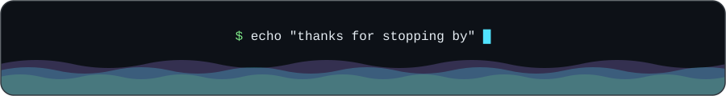

